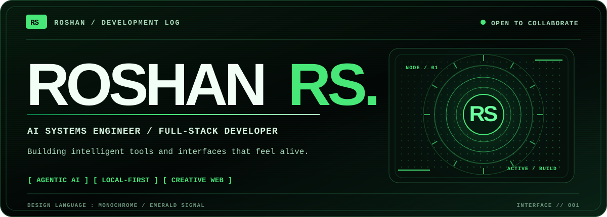
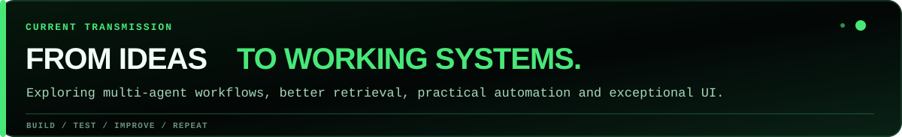
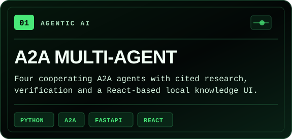
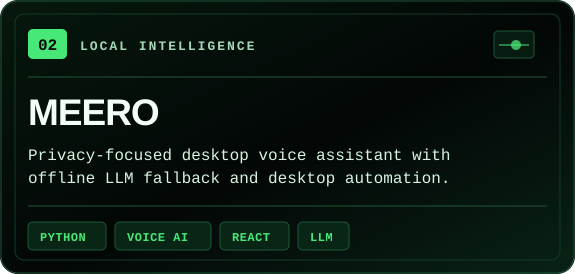
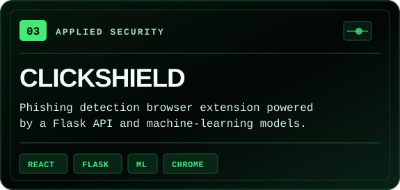
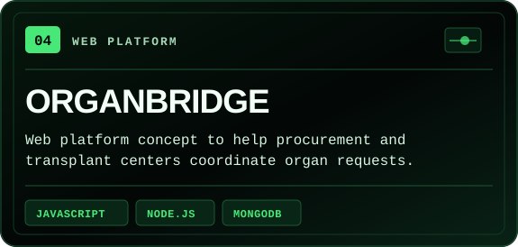
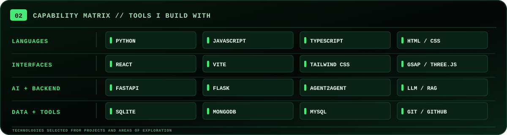
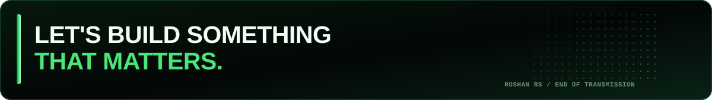

<!--
  ROSHAN RS // GITHUB PROFILE
  Theme: Nothing-inspired minimalism x Doom-inspired emerald signal.
  All art is original, self-contained SVG, stored in ./assets/ (no external image APIs).
  Tip: Upload README.md and the entire assets/ directory to Roshan-R-S/Roshan-R-S.

  
<a href="https://github.com/Roshan-R-S?tab=repositories">EXPLORE REPOSITORIES</a>
  ·  
<a href="mailto:roshanravi2k2@gmail.com">GET IN TOUCH</a>
  ·  
<a href="https://www.linkedin.com/in/roshan-rs006/">LINKEDIN</a>
 
  <code>AI AGENTS</code> &#160; <code>FULL STACK</code> &#160; <code>LOCAL-FIRST AI</code> &#160; <code>INTERACTIVE WEB</code>

`00` / About the builder
I'm Roshan RS — a developer working at the intersection of artificial intelligence, full-stack software, and interactive experiences.
I enjoy turning ambitious ideas into working prototypes, especially systems that combine intelligent agents, useful automation, and interfaces that are a pleasure to use.
Building: multi-agent AI systems and local-first assistant experiences.
Exploring: Agent2Agent (A2A), RAG, retrieval, LLM workflows, and voice interfaces.
Engineering with: Python, TypeScript, JavaScript, React, APIs, and databases.
Open to: interesting collaborations in open-source AI, ML, and full-stack development.

`01` / Featured systems

Selected work from my public repositories. Tap a panel to explore the source and documentation.

<table>
  <tr>
    <td width="50%" valign="top">
      
    </td>
    <td width="50%" valign="top">
      
    </td>
  </tr>
  <tr>
    <td width="50%" valign="top">
      
    </td>
    <td width="50%" valign="top">
      
    </td>
  </tr>
</table>
Creative side quest: Our 2 Year Journey — an interactive experience using React, TypeScript, GSAP, Three.js, and motion-rich UI.

`02` / Toolkit

  
<b>View toolkit as text</b>

Languages: Python, JavaScript, TypeScript, HTML, CSS
Frontend: React, Vite, Tailwind CSS, GSAP, Three.js
Backend / AI: FastAPI, Flask, A2A, LLM integration, RAG exploration
Data / development: SQLite, MongoDB, MySQL, Git, GitHub

`03` / Connect
I’m always interested in thoughtful products, practical AI, open-source projects, and creative engineering. Feel free to reach out.
EMAIL   /   LINKEDIN   /   DEV.TO   /   LEETCODE   /   INSTAGRAM
 

  DESIGNED WITH INTENTION &#160; · &#160; BUILT WITH CURIOSITY &#160; · &#160; KEEP SHIPPING

